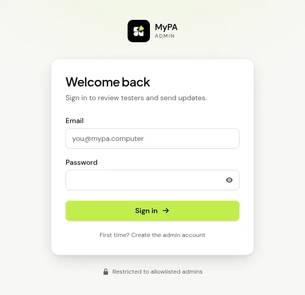
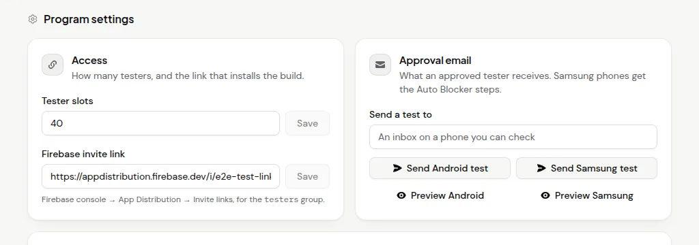
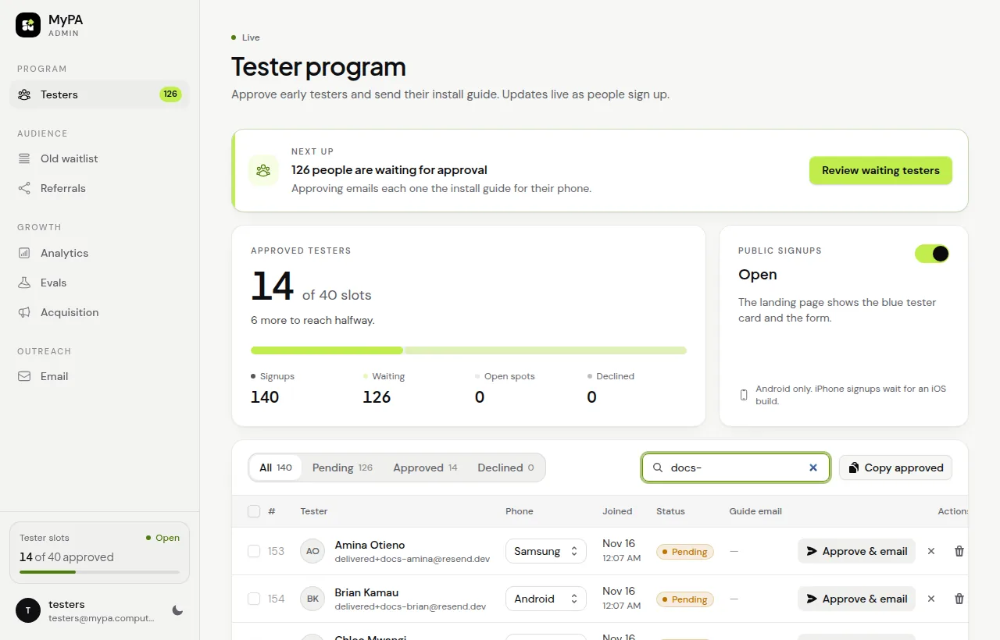
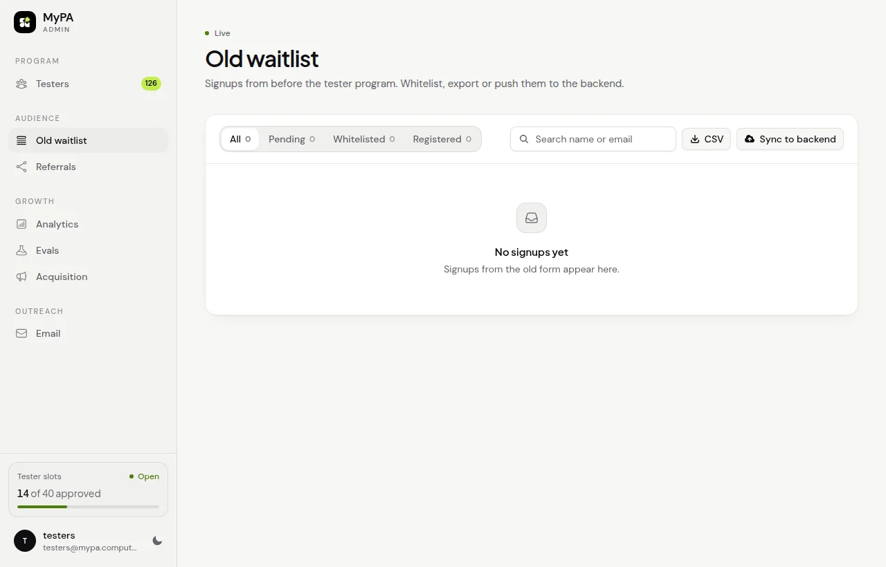
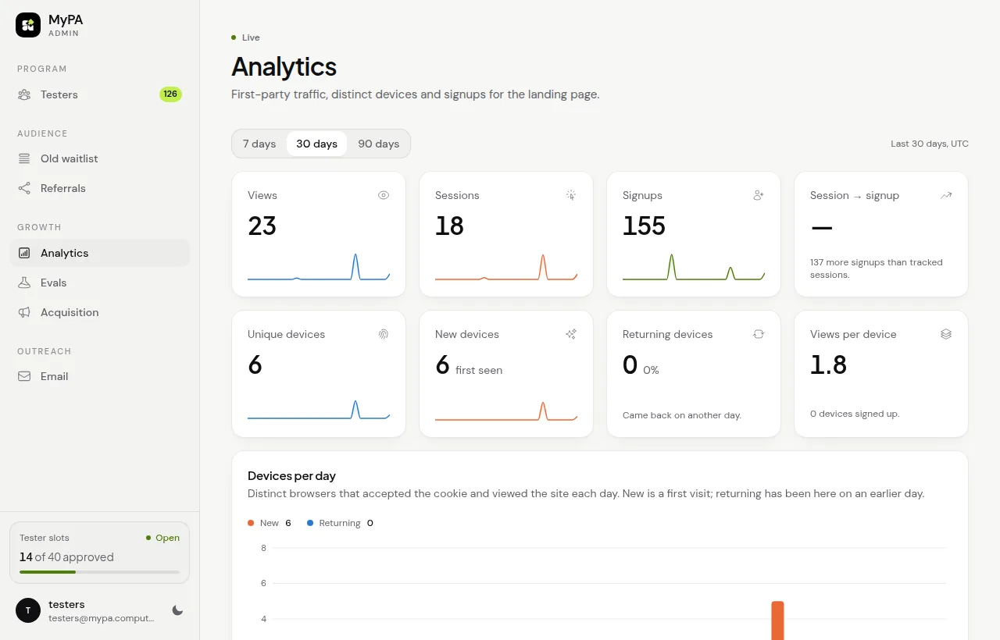
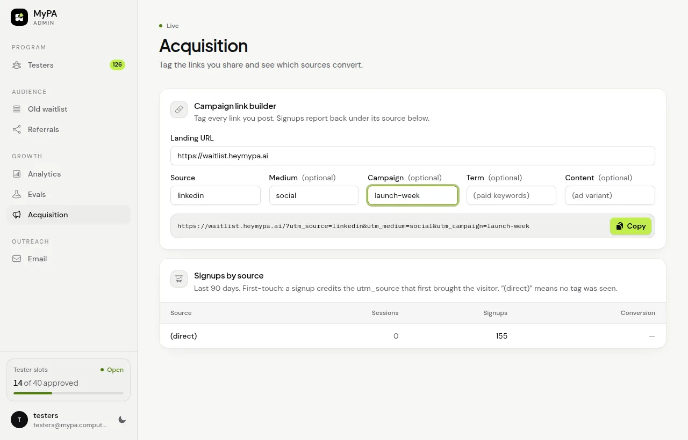
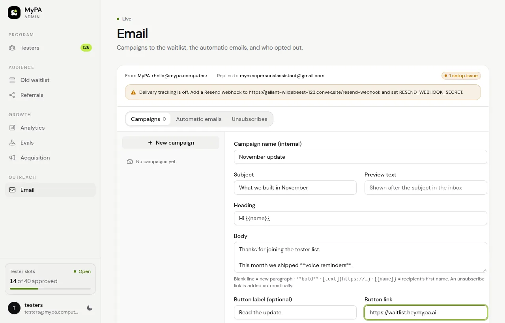
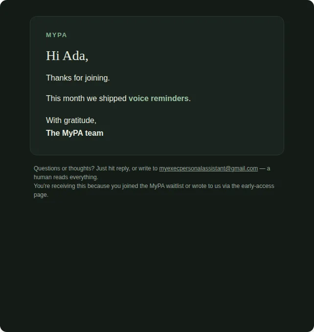

# Admin guide

How to run the MyPA tester program from the admin console. No coding needed.

Open **https://waitlist.heymypa.ai/admin**.

Everything on these pages updates live. When someone signs up, they appear without a refresh.

---

## 1. Sign in

1. Enter your admin email and password.
2. Click **Sign in**.

Only addresses on the admin allowlist can sign in. If yours is refused, ask a developer to add it (see [Production § Add or remove an admin](deploy.md#add-or-remove-an-admin)).

Ignore **First time? Create the admin account**. It only works while a developer has account creation switched on.

The moon icon at the bottom left switches between light and dark.

---

## 2. Set up the program (once)

Do this before you approve anyone. Scroll to the bottom of the **Testers** page, to **Program settings**.

1. **Tester slots**: how many testers you want. Type the number and click **Save**. The landing page shows how many spots are left.
2. **Firebase invite link**: in the Firebase console, open App Distribution → Invite links, and copy the link for the `testers` group. Paste it here and click **Save**.
   The **Approve & email** button stays switched off until this link is saved, because it is the main button in the approval email.
3. **Approval email**: type your own email in **Send a test to**, then click **Send Android test** and **Send Samsung test**. Open both on your phone and check that the invite button works. **Preview Android** and **Preview Samsung** show the email without sending it.
4. **Social links**: the links shown on the "spots filled" card once signups close, so people know where new spots will be announced. Up to six.

---

## 3. Approve a tester

The top card tells you what needs doing next, for example "126 people are waiting for approval". Click **Review waiting testers** to see only those people.

For each person:

1. Check the **Phone** column. If they picked the wrong phone, change it in the dropdown. Samsung phones get extra steps for Auto Blocker, so this matters.
2. Click **Approve & email**. They get the install guide for their phone straight away, and the **Guide email** column shows when it was sent.
3. Add them in Firebase. Click **Copy approved** to copy every approved email address, separated by commas. Paste the list in the Firebase console under App Distribution → Testers & Groups.

You cannot approve an iPhone user. The test build is Android only, so iPhone signups wait for an iOS build.

### Other actions on a row

| Button | What happens | Email sent? |
|---|---|---|
| **Approve & email** | Moves them to Approved and sends the install guide | Yes |
| **Resend guide** (approved rows) | Sends the install guide again | Yes |
| **Decline** (cross icon) | Moves them to Declined. Their spot goes back to the pool | No |
| **Back to pending** (curved arrow icon) | Undoes an approval or a decline | No |
| **Delete** (bin icon) | Click it, then click **Confirm delete**. Removes them for good | No |

### Find someone

- The tabs **All / Pending / Approved / Declined** filter the list. Each shows a count.
- The search box matches names and emails.
- **Rows** at the bottom sets how many people show per page.

---

## 4. Open or close signups

The **Public signups** card on the Testers page has one switch.

- **Open**: the landing page shows the blue tester card and the form.
- **Closed**: the landing page shows the amber "spots filled" card with your social links. New signups are refused.

When every slot is approved, the top card suggests **Close signups**.

---

## 5. Old waitlist

The people who joined through the form used before the tester program. Nobody joins this list any more.

- **Pending / Whitelisted / Registered** filter by status. Whitelisted means they get into the app at launch. Registered means they have created an account.
- Tick rows, then use **Whitelist selected** or **Mark pending**. **Whitelist all pending** does every pending person at once. None of these send an email.
- **CSV** downloads the list you are looking at, for a spreadsheet.
- **Sync to backend** sends whitelisted people to the MyPA app's own server, so they can sign up at launch. A green tick appears on each row once it has been sent.

---

## 6. Referrals

Each person on the old waitlist got a share link. This page ranks who brought in the most signups. **Copy referral link** copies a person's link. It stays empty until a shared link brings in a signup.

---

## 7. Analytics

Pick a **Date range** at the top. The page then shows:

- **Views, Sessions, Signups** and **Session → signup**: what share of visits ended in a signup.
- **Traffic**: views and visitors per day.
- **Signups per day**.
- **Top pages**, **Top referrers** (sites that sent people) and **Device types**.
- **Cookie consent** and **Devices**: how many visitors accepted or declined the cookie, and how many distinct phones or computers came back on another day. Only visitors who click **Accept** are counted as devices.
- **SEO health**: checks the share image, sitemap and robots file, with links to Google's, Facebook's and LinkedIn's preview checkers.

---

## 8. Evals

Automatic checks that the visitor tracking is honest. For example, that nobody gets a device cookie without accepting it, and that the daily totals match the raw page views. They run every day at 03:41 UTC. Pick a window and click **Run checks** to run them now.

Green means passing, amber means a warning, red means failing. If something is red, tell a developer.

---

## 9. Acquisition: tag the links you share

Use this whenever you post a link to the site, so you can see later which post brought people in.

1. **Landing URL** is filled in with the site address.
2. Type a **Source**, for example `linkedin`, `youtube` or `whatsapp`. Medium and Campaign are optional, for example `social` and `launch-week`.
3. Click **Copy**, and post the copied link.

**Signups by source** shows the last 90 days: visits and signups for each source, and the conversion rate. "(direct)" means the visitor came without a tagged link.

---

## 10. Email

The strip at the top shows who emails come **From** and where **Replies** go. An amber **setup issue** badge means something is missing. The message says what, and a developer can fix it ([Production § Email settings](deploy.md#email-settings)).

### Send an update (campaign)

1. Click **New campaign**.
2. Fill in:
   - **Campaign name**: only you see this.
   - **Subject** and **Preview text**: what shows in the inbox.
   - **Heading** and **Body**: leave a blank line between paragraphs. `**bold**` makes bold text, `[words](https://…)` makes a link, and `{{name}}` becomes each person's first name.
   - **Button label** and **Button link**: optional. Add both to show a button.
3. Pick the **Audience**.
4. Check the **Live preview** below the form.

   

5. Click **Save draft**.
6. Enter your own address in **Send a test to** and click **Send test**. Read it on your phone.
7. Click **Send to audience**. While it is sending, **Stop sending** halts the rest. Emails already sent cannot be recalled.

The campaign then lists every recipient and whether the email was delivered, opened or clicked, or bounced.

Campaigns go to the **old waitlist** only. Approved testers are not an audience here. They hear from you through the approval email.

Every campaign email has an unsubscribe link. People who unsubscribe, bounce or report spam are skipped automatically.

### Automatic emails

A preview of the welcome email the old waitlist form sent. The tester emails are previewed on the Testers page instead, under **Approval email**.

### Unsubscribes

Everyone who unsubscribed, bounced or marked an email as spam, and when.

---

## Something looks wrong

| You see | Try |
|---|---|
| "Server Error" on a page | Refresh. If it stays, tell a developer the page and the time |
| **Approve & email** is greyed out | The Firebase invite link is not saved (step 2) |
| The landing page still shows the form after you closed signups | Refresh the landing page. It updates within a few seconds |
| A tester says the email never arrived | Check spam first, then click **Resend guide** |
| Delivered/opened numbers stay at zero | Delivery tracking is off. See the amber notice on the Email page |
